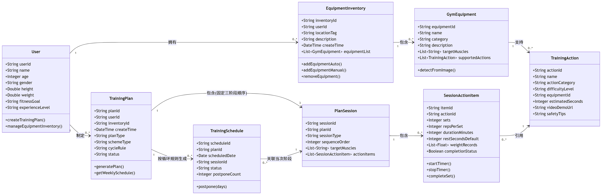

# 需求规格说明书

**毕设题目**：基于深度学习的健身管理系统设计与实现  
**版本**：2.1  
**日期**：2026年4月15日  
**学生姓名**：吉雅  
**学号**：6322000326  
**指导教师**：李罡

---

## 1. 用户涉众

本系统主要服务对象为“自主健身用户”与“健身初学者”，其描述与核心关注点如 表1-1 所示。

**表 1-1 系统面向的涉众群体**

| 涉众角色   | 描述                    | 核心关注点                                                                                         |
| ------ | --------------------- | --------------------------------------------------------------------------------------------- |
| 自主健身用户 | 在健身房无器械陪同下进行自主训练的普通用户 | 1. 快速识别陌生健身器材类型及用途 2. 获取与器材匹配的科学训练动作指导 3. 根据健身房实际可用器材生成个性化训练计划 4. 降低因器材使用不当导致的运动损伤风险 |
| 健身初学者  | 缺乏健身知识与经验的新手用户        | 1. 降低健身入门门槛，获得直观易懂的器材使用指导 2. 获得符合自身体能水平的动作推荐与计划安排 3. 避免因动作错误导致的训练效果低下或受伤                |

---

## 2. 业务对象

### 2.1 业务对象类图

健身管理系统的业务对象及其关系如图 2-1 所示。  
*(注：此处请插入类图，需包含新增的 `TrainingSchedule` 对象及其关联关系)*  
**图 2-1 业务关系类图**

### 2.2 业务对象属性与函数详细说明

#### 2.2.1 User（用户）

`User` 类的属性与函数的详细说明可查看表 2-1。  
**业务规则**：用户首次使用系统时必须完成基本信息录入，否则无法生成个性化训练计划；用户数据仅用于本系统内个性化服务，不对外共享。

**表 2-1 User 对象**

| 属性/函数                        | 类型      | 说明                                        |
| ---------------------------- | ------- | ----------------------------------------- |
| `userId`                     | String  | 用户唯一标识符，系统自动生成，用于关联用户所有数据                 |
| `name`                       | String  | 用户姓名或昵称，用于个性化界面展示                         |
| `age`                        | Integer | 用户年龄（岁），作为动作难度筛选与安全评估的依据                  |
| `gender`                     | String  | 用户性别（"male"/"female"/"other"），影响目标肌群训练侧重  |
| `height`                     | Double  | 身高（厘米），结合体重计算BMI，评估用户体能基础                 |
| `weight`                     | Double  | 体重（千克），结合身高计算BMI，作为训练强度参考                 |
| `fitnessGoal`                | String  | 健身目标（"减脂"/"增肌"），决定训练计划类型（V2.1修订）          |
| `experienceLevel`            | String  | 健身经验水平（"初学者"/"中级"/"高级"），影响动作难度与参数配置       |
| `createTrainingPlan()`       | 函数      | 启动训练计划生成流程：选择计划类型→系统筛选匹配动作→构建三阶段结构→输出完整计划 |
| `manageEquipmentInventory()` | 函数      | 进入器材清单管理界面：查看/创建/编辑/删除器材清单，管理清单内器材        |

#### 2.2.2 EquipmentInventory（器材清单）

`EquipmentInventory` 类的属性与函数的详细说明可查看表 2-2。  
**业务规则**：

1. 用户可创建多个器材清单，每个清单对应一个物理健身房；
2. 清单创建时必须指定归属标签，标签可重复使用（如多个用户可创建同名“家附近健身房”清单）；
3. 训练计划生成时必须指定目标器材清单，系统仅推荐该清单内器材支持的动作。

**表 2-2 EquipmentInventory 对象**

| 属性/函数                  | 类型                 | 说明                                                 |
| ---------------------- | ------------------ | -------------------------------------------------- |
| `inventoryId`          | String             | 器材清单唯一标识符，系统自动生成                                   |
| `userId`               | String             | 关联用户ID，标识该清单归属                                     |
| `locationTag`          | String             | 归属标签，用户自定义的物理位置标识（如"家附近健身房"、"公司健身房"），用于区分不同场地的器材配置 |
| `description`          | String             | 清单描述信息，用户可补充说明（如"24小时营业，器械较新"）                     |
| `createTime`           | DateTime           | 清单创建时间，用于排序与有效期管理                                  |
| `equipmentList`        | List<GymEquipment> | 该清单包含的健身器材集合，构成训练计划生成的物理约束条件                       |
| `addEquipmentAuto()`   | 函数                 | 自动添加模式：基于器材识别结果，将识别到的器材加入当前清单，用户需确认归属标签            |
| `addEquipmentManual()` | 函数                 | 手动添加模式：用户通过关键词搜索系统器材库，选择目标器材后手动加入清单                |
| `removeEquipment()`    | 函数                 | 从清单中移除指定器材，适用于器材淘汰或更换健身房场景                         |

#### 2.2.3 GymEquipment（健身器材）

`GymEquipment` 类的属性与函数的详细说明可查看表 2-3。  
**业务规则**：

1. 系统预置不少于 20 类的常见健身器材的标准信息库。
2. 器材识别准确率要求不低于 85%，单次识别响应时间不超过 2 秒。
3. 识别结果需提供置信度提示，置信度低于 70% 时提示用户调整拍摄角度重试。

**表 2-3 GymEquipment 对象**

| 属性/函数               | 类型                   | 说明                                          |
| ------------------- | -------------------- | ------------------------------------------- |
| `equipmentId`       | String               | 器材唯一标识符，系统预定义                               |
| `name`              | String               | 器材标准名称（如"史密斯机"、"坐姿推胸机"、"跑步机"）               |
| `category`          | String               | 器材分类（"力量训练-自由重量"/"力量训练-固定器械"/"有氧器械"/"辅助器材"） |
| `description`       | String               | 器材功能描述与使用场景说明                               |
| `targetMuscles`     | List<String>         | 该器材主要锻炼的目标肌群列表（如["胸大肌","三角肌前束","肱三头肌"]）     |
| `supportedActions`  | List<TrainingAction> | 该器材支持的标准训练动作集合，构成器材-动作知识图谱基础                |
| `detectFromImage()` | 函数                   | 启动器材识别流程：接收用户上传图像 → 调用识别引擎 → 返回识别结果与置信度     |

#### 2.2.4 TrainingAction（训练动作）

`TrainingAction` 类的属性与函数的详细说明可查看表 2-4。  
**业务规则**：

1. 系统预置不小于 100 个标准训练动作，覆盖四类动作类别。
2. 动作推荐时需校验用户器材清单是否包含所需器材。
3. 动作难度需与用户经验水平匹配（初学者不推荐高级动作）。

**表 2-4 TrainingAction 对象**

| 属性/函数              | 类型           | 说明                                                                          |
| ------------------ | ------------ | --------------------------------------------------------------------------- |
| `actionId`         | String       | 动作唯一标识符，系统预定义                                                               |
| `name`             | String       | 动作标准名称（如"杠铃深蹲"、"坐姿划船"、"高抬腿"）                                                |
| `actionCategory`   | String       | 动作类别，决定动作在训练计划中的适用阶段，包含 `warmup`、`main_cardio`、`main_strength` 和 `cooldown` |
| `targetMuscles`    | List<String> | 动作主要锻炼的目标肌群列表（如["股四头肌","臀大肌","核心肌群"]）                                       |
| `difficultyLevel`  | String       | 动作难度等级（"初级"/"中级"/"高级"），结合用户经验水平进行匹配                                         |
| `equipmentId`      | String       | 关联器材ID，引用 `GymEquipment` 对象的唯一标识符，标识执行该动作所需的核心器材                            |
| `estimatedSeconds` | Integer      | 单次估算时长（秒），指完成一次标准动作所需的平均时间，主要用于力量训练类                                        |
| `videoDemoUrl`     | String       | 标准动作演示视频资源地址，包含多角度示范与常见错误对比                                                 |
| `safetyTips`       | String       | 安全注意事项与常见错误纠正提示（如"保持背部挺直，避免弓腰"；复合动作需说明辅助器材）                                 |

#### 2.2.5 TrainingPlan（训练计划）【V2.1修订】

**业务规则**：

1. 计划表中不再包含有效期（`valid_days`）和总时长（`total_duration_minutes`）字段。
2. 健身目标仅分为"减脂"和"增肌"两类。
3. 计划必须关联有效器材清单，确保所有推荐动作均可在目标健身房执行。
4. 计划生成时需指定计划类型（减脂计划/增肌计划），增肌计划需指定分化方案。

**表 2-5 TrainingPlan 对象**

| 属性/函数                 | 类型       | 说明                                                               |
| --------------------- | -------- | ---------------------------------------------------------------- |
| `planId`              | String   | 计划唯一标识符，系统自动生成                                                   |
| `userId`              | String   | 计划归属用户 ID                                                        |
| `inventoryId`         | String   | 关联器材清单 ID，标识该计划基于哪个健身房的器材配置生成                                    |
| `createTime`          | DateTime | 计划生成时间                                                           |
| `planType`            | String   | 计划类型（"FAT_LOSS"/"MUSCLE_GAIN"），决定训练计划类型                          |
| `schemeType`          | String   | 分化方案（仅增肌计划有效："ONE_SPLIT"/"TWO_SPLIT"/"THREE_SPLIT"/"FOUR_SPLIT"） |
| `cycleRule`           | String   | 训练循环规则（如"练 3 休 1"、"练 2 休 1"等）                                    |
| `status`              | String   | 计划状态（"ACTIVE"/"ARCHIVED"）                                        |
| `generatePlan()`      | 函数       | 启动训练计划生成流程：选择计划类型→系统筛选匹配动作→构建三阶段结构→输出完整计划                        |
| `getWeeklySchedule()` | 函数       | 获取从当天开始的 7 天训练安排                                                 |

#### 2.2.6 PlanSession（计划阶段）【V2.1修订】

**业务规则**：

1. 三阶段顺序固定不可调整，符合运动生理学训练原则。
2. 三个阶段的目标肌群需保持一致性。
3. 热身阶段仅包含 `warmup` 类别动作，拉伸阶段仅包含 `cooldown` 类别动作。
4. 正式训练阶段根据计划类型选择动作（减脂：无氧+有氧；增肌：力量）。

**表 2-6 PlanSession 对象**

| 属性/函数           | 类型                      | 说明                                                 |
| --------------- | ----------------------- | -------------------------------------------------- |
| `sessionId`     | String                  | 阶段唯一标识符，系统自动生成                                     |
| `planId`        | String                  | 关联计划 ID                                            |
| `sessionType`   | String                  | 阶段类型，严格限定三类：`warmup`（热身）、`main`（正式）、`cooldown`（拉伸） |
| `sequenceOrder` | Integer                 | 阶段执行顺序（1=热身，2=正式，3=拉伸），系统自动生成且不可调整                 |
| `targetMuscles` | List<String>            | 该阶段目标肌群列表，需与同一计划的其他阶段保持一致                          |
| `actionItems`   | List<SessionActionItem> | 该阶段包含的动作项集合，按执行顺序排列                                |

#### 2.2.7 SessionActionItem（阶段动作项）【V2.1修订】

**业务规则**：

1. 支持用户记录每组的训练重量，系统生成计划时重量为空。
2. 休息时长默认 60s（减脂无氧/增肌/休息弹窗默认），用户可调整（30s 至 5 分钟）。
3. 支持动作替换、添加（需符合器材约束）、删除。
4. 每组完成后触发休息倒计时，结束后播放提示音。

**表 2-7 SessionActionItem 对象**

| 属性/函数                | 类型          | 说明                                    |
| -------------------- | ----------- | ------------------------------------- |
| `itemId`             | String      | 动作项唯一标识符，系统自动生成                       |
| `actionId`           | String      | 引用的训练动作 ID，关联 `TrainingAction` 对象     |
| `sets`               | Integer     | 组数，范围 1-6 组（默认 4 组）                   |
| `repsPerSet`         | Integer     | 每组次数，仅适用于力量训练类动作，范围 5-20 次/组（默认 12 次） |
| `durationMinutes`    | Integer     | 持续时长（分钟），仅适用于有氧动作（默认 30 分钟）           |
| `restSecondsDefault` | Integer     | 默认组间休息时间（秒），范围 30-300 秒（默认 60 秒）      |
| `weightRecords`      | List<Float> | 每组训练的重量记录（kg），生成时为空，用户训练时填写           |
| `completionStatus`   | Boolean     | 动作项完成状态                               |
| `startTimer()`       | 函数          | 开始训练计时                                |
| `stopTimer()`        | 函数          | 结束训练计时                                |
| `completeSet()`      | 函数          | 完成一组动作，触发休息倒计时                        |

#### 2.2.8 TrainingSchedule（训练日程）【V2.1新增】

**业务规则**：

1. 页面中只显示从当天开始的 7 天训练安排。
2. 支持延后训练，可延后一天、两天、三天。
3. 根据计划的循环规则（如练 3 休 1）自动生成日程。

**表 2-8 TrainingSchedule 对象**

| 属性/函数           | 类型      | 说明                                           |
| --------------- | ------- | -------------------------------------------- |
| `scheduleId`    | String  | 日程唯一标识符                                      |
| `planId`        | String  | 关联计划 ID                                      |
| `scheduledDate` | Date    | 计划训练日期                                       |
| `sessionId`     | String  | 当次训练对应的阶段 ID（通常指正式训练阶段）                      |
| `status`        | String  | 状态（"PLANNED"/"COMPLETED"/"POSTPONED"/"REST"） |
| `postponeCount` | Integer | 延后次数，限制最大延后 3 天                              |
| `postpone()`    | 函数      | 延后训练，参数为延后天数（1-3）                            |

### 2.3 业务关系详细说明

1. **用户与器材清单**：一对多关系。一个用户可创建多个器材清单；一个器材清单仅归属于一个用户。
2. **器材清单与健身器材**：一对多关系。一个器材清单可包含多个健身器材。支持自动识别添加与手动搜索添加。
3. **健身器材与训练动作**：一对多关系。一种器材支持多个动作。一个动作主要关联一种核心器材。无器械动作的 `equipmentId="none"`。
4. **用户与训练计划**：一对多关系。一个用户可拥有多个训练计划。一个训练计划仅归属于单一用户，且必须关联一个有效器材清单。
5. **训练计划与计划阶段**：一对多有序关系。一个训练计划必须且仅包含三个阶段：热身 → 正式 → 拉伸。阶段顺序严格固定，不可调整。
6. **计划阶段与阶段动作项**：一对多关系。一个计划阶段可拥有多个阶段动作项。
7. **阶段动作项与训练动作**：多对一引用关系。阶段动作项是训练动作在具体计划中的实例化。
8. **【新增】训练计划与训练日程**：一对多关系。系统根据计划的 `cycleRule` 自动生成未来日程。一个日程记录对应某一天的具体训练任务，支持状态追踪与延期操作。

### 2.4 训练计划生成与执行核心业务规则（V2.1专项）

1. **计划生成前置条件**：生成计划时，系统必须从指定健身房（器材清单）中所拥有的器材所支持的动作中进行选择。若用户器材清单为空，不可生成计划。动作难度需符合用户的经验水平。用户在生成计划页面需首先选择生成"减脂计划"还是"增肌计划"。
2. **减脂计划逻辑**：包含热身（3个激活动作）、正式训练（先无氧后有氧）、拉伸（3个拉伸动作）。无氧默认4个力量动作（4组×12次，组歇60s可调整）；有氧默认30分钟跑步机爬坡（若无跑步机则推荐替代有氧）。默认按"练3休1"循环。
3. **增肌计划逻辑**：支持四种分化方案（一分化/二分化/三分化/四分化）。正式训练仅支持力量动作。各分化方案的动作量、频率与内容详见用例与逻辑定义。
4. **训练执行交互**：点击"开始训练"计时，点击"结束"停止。每组完成后触发休息倒计时（默认60s，可调30s-5min），结束播放提示音。支持动作替换/添加/删除（受器材约束）。日程页仅显示未来7天，支持最多延后3天。

---

## 3. 用例分析

### 3.1 用例图

系统训练计划模块的用例主要包括：生成训练计划、查看训练日程、执行训练、管理训练动作、延后训练。所有用例的参与者均为"所有用户"（已登录）。  
*(注：此处请插入用例图)*  
**图 3-1 用例图**

### 3.2 用例描述

*(注：以下为完整用例列表。基础用例保持原版逻辑，核心训练模块已按 V2.1 全面升级)*

**表 3-1 注册**
| 项目 | 内容 |
| :--- | :--- |
| **用例名称** | 注册 |
| **用例参与者** | 所有用户 |
| **概述** | 用户注册账号 |
| **前置条件** | 无 |
| **基本事件流** | 1. 用户在登录页面点击注册 → 系统跳转至注册页面 2. 用户填写手机号、密码和确认密码 → 系统验证密码一致性 3. 用户点击确认注册 → 系统自动配置用户id，提示注册成功，返回登录页面 |
| **扩展事件流** | (2a) 密码不符合要求提示规范 (2b) 两次密码不一致提示重输 |

**表 3-2 登录**
| 项目 | 内容 |
| :--- | :--- |
| **用例名称** | 登录 |
| **用例参与者** | 所有用户 |
| **概述** | 用户登录系统 |
| **前置条件** | 注册账号 |
| **基本事件流** | 1. 用户填写手机号和密码点击登录 → 系统验证通过跳转至首页 |
| **扩展事件流** | (1a) 手机号不存在提示注册 (1b) 密码错误提示重试 |

*(其他基础用例：忘记密码、编辑身体数据、编辑个人资料、编辑账号与安全、识别健身器材、推荐训练动作、管理健身房、添加器材（自动/手动）、查看器材、删除器材、查看动作指导 均保持原版逻辑，此处为节省篇幅省略，可按原版文档直接补充)*

**表 3-10 生成训练计划【V2.1修订】**
| 项目 | 内容 |
| :--- | :--- |
| **用例名称** | 生成训练计划 |
| **用例参与者** | 所有用户 |
| **概述** | 用户选择计划类型及方案，系统基于器材清单生成个性化计划 |
| **前置条件** | 1. 用户已录入身体基本数据和健身目标（减脂/增肌） 2. 用户至少拥有一个健身房的器材信息 3. 器材清单内器材数量满足生成计划最低要求 |
| **基本事件流** | 1. 用户进入计划生成页面 → 系统展示计划类型选择 2. 用户选择计划类型 → 若选增肌，系统展示分化方案选择 3. 用户选择分化方案 → 用户选择目标健身房（器材清单） 4. 系统根据器材清单、经验水平及计划逻辑筛选动作 5. 系统构建三阶段计划（热身/正式/拉伸）→ 系统展示计划详情 6. 用户确认 → 系统保存计划并生成后续 7 天日程 |
| **扩展事件流** | (4a) 器材不足提示添加器材 (6a) 用户可调整组数、次数、休息时长 (6b) 用户可替换、添加或删除动作（受器材约束） |

**表 3-11 执行训练【V2.1新增】**
| 项目 | 内容 |
| :--- | :--- |
| **用例名称** | 执行训练 |
| **用例参与者** | 所有用户 |
| **概述** | 用户按照计划进行训练，系统提供计时、休息提示及重量记录功能 |
| **前置条件** | 1. 用户已生成训练计划 2. 当前日期有安排的训练任务 |
| **基本事件流** | 1. 用户进入训练执行页面 → 点击"开始训练"系统计时 2. 用户完成一组动作点击"确认完成" → 系统弹出休息倒计时（默认60s） 3. 用户可调整休息时长 → 倒计时结束系统播放提示音 4. 用户记录该组重量（可选） → 完成所有动作点击"结束"系统保存记录 |
| **扩展事件流** | (2a) 用户可跳过休息直接进入下一组 (4a) 用户可选择不记录重量 |

**表 3-12 管理训练动作【V2.1新增】**
| 项目 | 内容 |
| :--- | :--- |
| **用例名称** | 管理训练动作 |
| **用例参与者** | 所有用户 |
| **概述** | 用户在计划生成后或执行前，对计划内的动作进行调整 |
| **前置条件** | 1. 用户已生成训练计划 2. 计划处于未归档状态 |
| **基本事件流** | 1. 用户进入计划详情或编辑页面 → 选择动作项 2. 用户选择操作类型（替换/添加/删除） 3. 若替换/添加，系统展示推荐动作列表（基于器材清单过滤） 4. 用户确认选择 → 系统更新计划动作项 |
| **扩展事件流** | (3a) 添加非支持器材动作提示"该动作所需器材您当前健身房未配备" |

**表 3-13 查看与延后训练日程【V2.1新增】**
| 项目 | 内容 |
| :--- | :--- |
| **用例名称** | 查看与延后训练日程 |
| **用例参与者** | 所有用户 |
| **概述** | 用户查看未来 7 天训练安排，并可对当天的训练进行延后 |
| **前置条件** | 1. 用户已生成训练计划 2. 计划处于激活状态 |
| **基本事件流** | 1. 用户进入计划日程页面 → 系统展示从当天开始的 7 天训练安排 2. 用户点击当天的训练任务 → 选择"延后训练" 3. 用户选择延后天数（1/2/3天） → 系统更新日程安排，后续顺延 |
| **扩展事件流** | (3a) 已达最大延后次数提示"最多支持延后 3 天" |

---

## 4. 数据库 Schema 变更说明（V2.1新增）

为支持新的业务逻辑，需对数据库表结构进行以下变更：

1. **`training_plan` 表**：
   
   - **删除字段**：`valid_days` (INT), `total_duration_minutes` (INT)。
   - **新增字段**：
     - `plan_type` (ENUM): `'FAT_LOSS'`, `'MUSCLE_GAIN'`。
     - `scheme_type` (ENUM): `'ONE_SPLIT'`, `'TWO_SPLIT'`, `'THREE_SPLIT'`, `'FOUR_SPLIT'` (nullable, 仅增肌计划使用)。
     - `cycle_rule` (VARCHAR): 存储循环规则描述（如"练 3 休 1"）。
   - **修改字段**：原 `fitness_goal` 字段约束改为仅允许 `'FAT_LOSS'`, `'MUSCLE_GAIN'`。

2. **`session_action_item` 表**：
   
   - **新增字段**：
     - `rest_seconds_default` (INT): 默认休息时长（默认 60 秒）。
     - `weight_records` (JSON): 存储每组重量记录，如 `[10.5, 10.5, 10.0, 10.0]`。
     - `duration_minutes` (INT): 用于有氧动作时长（nullable）。

3. **新增表 `training_schedule`**：
   
   - 用于存储 7 天训练日程及延后状态。
   - 字段：`schedule_id` (PK), `plan_id` (FK), `scheduled_date` (DATE), `session_id` (FK), `status` (VARCHAR), `postpone_count` (INT)。

---

## 5. 系统页面原型图（修订）

在原基础上新增/修改以下核心页面原型以支持 V2.1 逻辑：

- 图 4-1 ~ 图 4-14（登录、注册、首页、动作库、健身房管理等基础页面保持原版）
- **图 4-15 计划生成选择页**：选择减脂/增肌，增肌需选择分化方案（一分化/二分化/三分化/四分化）。
- **图 4-16 计划详情与编辑页**：展示三阶段（热身/正式/拉伸），支持动作替换、添加、删除（带器材过滤提示），显示默认组数、次数及休息时长。
- **图 4-17 训练执行页**：包含开始/结束计时按钮，动作列表，每组后的"确认完成"按钮，及重量记录输入框。
- **图 4-18 休息倒计时弹窗**：可调整休息时长（30s-5min），默认 60 秒，倒计时结束带音效提示。
- **图 4-19 7 天训练日程页**：卡片式或列表式展示未来 7 天安排，支持延后操作（1-3 天选项），清晰标注休息日与训练日。

---

## 6. 修订说明（V2.1）

本次修订主要变更内容如下：

| 修订项         | 原内容（V2.0）                                 | 修订后内容（V2.1）                                                       | 影响范围                           |
| ----------- | ----------------------------------------- | ----------------------------------------------------------------- | ------------------------------ |
| **计划核心字段**  | 包含 `valid_days`, `total_duration_minutes` | 移除有效期与总时长字段，新增 `plan_type`, `scheme_type`, `cycle_rule`, `status` | `TrainingPlan` 表结构、业务规则        |
| **分化训练逻辑**  | 未明确分化方案                                   | 明确增肌计划支持一至四分化，规定各方案频率、动作量与肌群划分                                    | 计划生成算法、用例描述                    |
| **休息时长默认值** | 默认 30 秒                                   | 默认 60 秒，支持用户 30s~5min 手动调整                                        | `SessionActionItem`、训练执行页、休息弹窗 |
| **重量与计时记录** | 无重量记录，总时长自动计算                             | 新增 `weightRecords` (JSON)，移除自动总时长计算，支持单组计时与完成状态                   | 动作项表结构、执行交互逻辑                  |
| **日程管理**    | 无独立日程模块                                   | 新增 `TrainingSchedule` 对象，实现7天视图、循环规则推演、延期机制                       | 数据库、用例、前端日程页                   |
| **用例体系**    | 仅覆盖生成与查看                                  | 扩展至“执行训练”、“管理训练动作”、“查看与延后日程”完整闭环                                  | 第3章用例描述                        |

**版本号**：2.1  
**修订日期**：2026 年 4 月 15 日  
**修订人**：吉雅  
**审核人**：李罡
